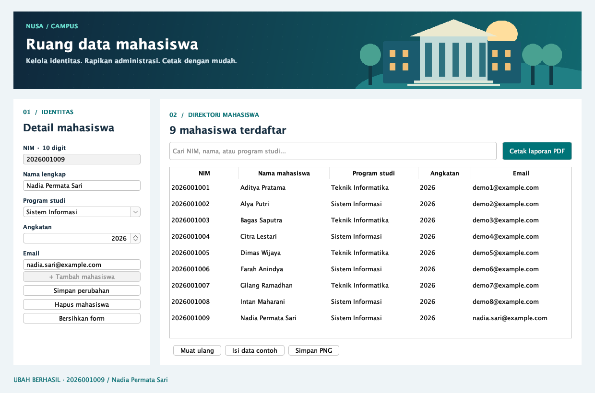

# Aplikasi-data-mahasiswa-dengan-CRUD

Aplikasi desktop data mahasiswa untuk UAS PBO menggunakan Java Swing, SQLite, dan JasperReports.

Fitur: tambah, tampil, ubah, hapus, pencarian mahasiswa, serta laporan PDF berdasarkan rentang NIM dengan logo dan nomor halaman.



## Menjalankan

Memerlukan JDK 11+ dan Maven 3.9+. Dari folder repository:

```sh
cd nusa-campus
mvn clean package
java -jar target/nusa-campus.jar
```

Setelah build, bisa juga menggunakan `run.command` (macOS) atau `run.bat` (Windows) di folder `nusa-campus`. Klik **Isi data contoh** pada aplikasi untuk memulai dengan delapan mahasiswa fiktif.

- [Panduan lengkap dan penjelasan PBO](nusa-campus/README.md)
- [Source code](nusa-campus/src/main/java/id/ac/nusa)
- [Bukti CRUD dan laporan](nusa-campus/captures)
- [Contoh laporan PDF](nusa-campus/reports/contoh-laporan.pdf)

Lima pengujian integrasi lulus pada build lokal: CRUD, persistensi, validasi, filter NIM, serta nomor dan total halaman PDF. Database lokal dan hasil build tidak disimpan dalam repository.
