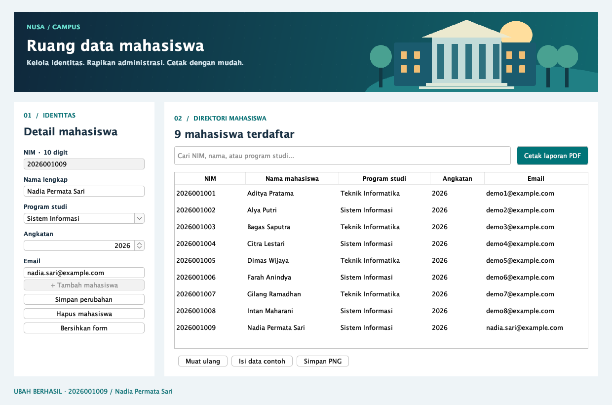

# Aplikasi-data-mahasiswa-dengan-CRUD

Proyek UAS Pemrograman Berorientasi Objek: aplikasi desktop Java Swing, database SQLite, dan laporan PDF menggunakan JasperReports. Tema biru–toska menggunakan ilustrasi kampus serta logo orisinal yang dibuat dengan Java2D.



## Menjalankan aplikasi

Memerlukan **JDK 11 atau lebih baru** (disarankan JDK 17/21). Proyek telah dibangun dan diuji menggunakan OpenJDK 25. Java 8 bawaan sebagian komputer tidak cukup.

Paket ZIP yang diberikan sudah menyertakan `target/nusa-campus.jar` beserta seluruh dependensinya di dalam JAR. Ekstrak ZIP terlebih dahulu.

- **macOS:** klik dua kali `run.command`, atau jalankan `sh run.command` di Terminal. Script mengenali OpenJDK Homebrew di komputer ini.
- **Windows:** klik dua kali `run.bat`; pastikan `JAVA_HOME` menunjuk JDK yang sesuai atau `java` di PATH sudah versi 11+.
- **Linux/terminal:** `java -jar target/nusa-campus.jar` dari folder proyek.

Database otomatis dibuat pada `data/mahasiswa.db`. Aplikasi awalnya kosong: klik **Isi data contoh** untuk memasukkan delapan mahasiswa fiktif. Tombol ini hanya bekerja saat database kosong. Semua perubahan tersimpan setelah aplikasi ditutup. Aplikasi tidak memerlukan internet saat digunakan.

## Cara menggunakan

1. **Tambah:** isi NIM, nama lengkap, program studi, angkatan, dan email; klik **Tambah mahasiswa**.
2. **Baca:** tabel menampilkan data dari SQLite. Gunakan kotak pencarian untuk mencari NIM/nama/program studi. Klik judul kolom untuk mengurutkan.
3. **Ubah:** pilih baris, edit data di form, lalu klik **Simpan perubahan**. NIM menjadi identitas tetap dan tidak dapat diubah; untuk koreksi NIM, hapus record lama lalu tambahkan yang benar.
4. **Hapus:** pilih baris, klik **Hapus mahasiswa**, lalu setujui konfirmasi.
5. **Laporan:** klik **Cetak laporan PDF**, isi NIM awal dan akhir, lalu tentukan lokasi file. Rentang bersifat inklusif. Rentang `0000000000`–`9999999999` mencetak semua data.
6. **Screenshot:** klik **Simpan PNG** untuk menyimpan tampilan panel aplikasi ke folder `captures`.

NIM ditetapkan **10 digit angka** sebagai konvensi proyek. Nol di depan dipertahankan karena NIM disimpan sebagai teks. Nama 2–80 karakter, program studi maksimal 60 karakter, angkatan 2000–2100, dan email wajib berformat valid. Program studi boleh diketik sendiri. Data contoh memakai domain `example.com`.

Laporan mengikuti rentang NIM yang dimasukkan, terlepas dari pencarian di tabel. Rentang terbalik dan rentang tanpa hasil ditolak dengan pesan yang jelas. PDF tidak ditulis jika hasil kosong. Nomor halaman menggunakan `$V{PAGE_NUMBER}`; total halaman dievaluasi saat akhir laporan (`evaluationTime="Report"`).

```sql
SELECT nim, name, program, year, email
FROM students
WHERE nim >= $P{NIM_FROM} AND nim <= $P{NIM_TO}
ORDER BY nim
```

Parameter JasperReports diikat ke prepared statement. Karena semua NIM memiliki panjang sama dan hanya berisi angka, urutan teks sesuai urutan numeriknya.

## Struktur dan konsep PBO

```text
src/main/java/id/ac/nusa/
  Main.java                Titik masuk aplikasi
  Student.java             Model immutable dan validasi
  StudentRepository.java   DAO: akses SQLite dengan JDBC
  StudentPanel.java        Tampilan Swing dan event CRUD
  ReportService.java       Kompilasi, pengisian, ekspor JasperReports
  DemoCapture.java         Demo CRUD dan pembuat bukti PNG
src/main/resources/
  images/                  Logo dan gambar latar kampus
  reports/students.jrxml    Template laporan dengan WHERE
src/test/java/             Pengujian integrasi JUnit
captures/                 Bukti tampilan CRUD dan laporan
reports/contoh-laporan.pdf Contoh PDF NIM 2026001002–2026001007
tools/GenerateArtwork.java Sumber ilustrasi Java2D
```

- **Enkapsulasi:** koneksi database, komponen form, dan proses laporan dikelola oleh kelas masing-masing; model `Student` immutable.
- **Abstraksi:** UI memanggil operasi repository tanpa menulis SQL secara langsung.
- **Pewarisan:** `StudentPanel` mewarisi `JPanel`.
- **Polimorfisme:** override `paintComponent`, `isCellEditable`, dan `SwingWorker` untuk perilaku khusus.
- **Komposisi:** panel menggunakan repository; service laporan juga menggunakan repository.
- **Penanganan exception:** validasi serta kegagalan database/laporan ditampilkan kepada pengguna, resource ditutup dengan try-with-resources.

## Build dari source

Instal JDK 11+ dan Maven 3.9+, pastikan `java -version` dan `mvn -version` memakai JDK tersebut.

```sh
mvn clean package
java -jar target/nusa-campus.jar
```

Build pertama memerlukan internet untuk mengunduh dependensi Maven. `mvn clean package` menjalankan pengujian sebelum menghasilkan JAR siap pakai. NetBeans/IntelliJ dapat membuka folder ini sebagai proyek Maven melalui `pom.xml`.

Dependensi utama: JasperReports 6.21.3, SQLite JDBC 3.46.1.0, FlatLaf 3.5.4. Font DejaVu dari paket JasperReports Fonts disertakan dan ditanamkan dalam PDF.

## Verifikasi dan bukti

Lima pengujian integrasi menguji CRUD dan persistensi setelah koneksi dibuka kembali, NIM duplikat, pencarian dengan karakter khusus, validasi, keamanan pemuatan data contoh, batas rentang inklusif, rentang kosong/terbalik, serta nomor dan total halaman pada PDF 80 mahasiswa. Pengujian membaca teks PDF yang benar-benar diekspor.

```sh
mvn test
java -Djava.awt.headless=true -jar target/nusa-campus.jar --demo-captures
```

Perintah demo menggunakan **database sementara terpisah**, menjalankan metode CRUD yang sama dengan tombol UI, merender panel Swing asli ke PNG, lalu mengekspor laporan dengan JasperReports. Demo tidak mengubah database pengguna. Perintah tersebut menimpa lima PNG demo dan PDF contoh.

| File | Bukti |
|---|---|
| `captures/01-read.png` | Delapan mahasiswa dibaca dari SQLite |
| `captures/02-create.png` | Nadia ditambahkan; total sembilan |
| `captures/03-update.png` | Nama, prodi, dan email Nadia diperbarui |
| `captures/04-delete.png` | Nadia dihapus; total delapan |
| `captures/05-report.png` | Halaman laporan asli hasil JasperReports |

PNG merupakan render panel aplikasi dan halaman laporan, bukan screenshot seluruh desktop. Dialog OS (pilih file, konfirmasi hapus) belum diuji lewat klik otomatis; alur CRUD, render Swing, ekspor PDF, serta isi PDF telah diuji. Bila dosen meminta screenshot desktop, jalankan aplikasi dan ambil screenshot manual tambahan.

Untuk membuat ulang gambar latar dan logo:

```sh
java -Djava.awt.headless=true tools/GenerateArtwork.java
mvn package
```

## Repository GitHub

Repository proyek: [Aplikasi-data-mahasiswa-dengan-CRUD](https://github.com/pinuji8888/Aplikasi-data-mahasiswa-dengan-CRUD).

Untuk mengambil dan membangun source dari repository:

```sh
git clone https://github.com/pinuji8888/Aplikasi-data-mahasiswa-dengan-CRUD.git
cd Aplikasi-data-mahasiswa-dengan-CRUD/nusa-campus
mvn clean package
java -jar target/nusa-campus.jar
```

Folder `captures` dan contoh PDF disertakan; database lokal serta hasil build `target` diabaikan oleh `.gitignore`. Pengguna repository perlu membangun JAR dengan Maven. URL repository dapat digunakan sebagai jawaban pengumpulan UAS. Keunikan desain terhadap pekerjaan teman sekelas tidak dapat diverifikasi dari proyek ini.

Referensi template: [JasperReports 6.21.3 schema](https://jasperreports.sourceforge.net/6.21.3/schema.reference.html) dan [dokumentasi evaluasi variabel](https://jasperreports.sourceforge.net/6.21.3/api/net/sf/jasperreports/engine/JREvaluation.html).
